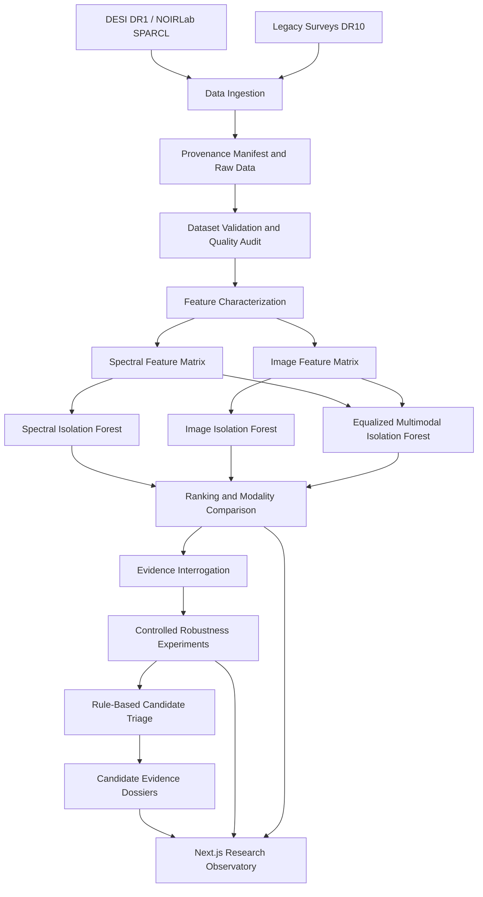

# LIMEN
### Multimodal Astronomical Outlier Discovery through Representation Learning, Physics-Model Discrepancy, and Cross-Survey Validation

**Where the unexplained begins.**

<p align="center">
  <a href="https://limen-astronomical-observatory-theta.vercel.app/">
    
  </a>
  <a href="https://github.com/Vmuktha/limen-astronomical-observatory">
    
  </a>
</p>

<p align="center">
  <b>A research-oriented, evidence-aware framework for investigating astronomical outliers using spectroscopy, optical imaging, anomaly-ranking baselines, data-quality diagnostics, and controlled robustness analysis.</b>
</p>

---

## 1. Overview

Modern astronomical surveys produce enormous volumes of observations. Identifying unusual objects within these datasets is not simply a matter of finding observations with extreme numerical values. An apparently unusual spectrum may be affected by poor wavelength coverage, noisy measurements, pixel masks, or uncertain redshift fitting. An unusual image may reflect imaging artifacts, background variation, or limitations in the available resolution.

A reliable outlier-investigation workflow therefore needs to examine more than anomaly scores. It must consider the quality, provenance, consistency, and stability of the underlying evidence.

**LIMEN** addresses this problem through a multimodal research pipeline that investigates astronomical observations using two complementary sources of evidence:

- **Spectroscopy:** spectral flux, wavelength structure, inverse variance, pixel masks, signal-to-noise characteristics, and available spectral-model residuals.
- **Optical imaging:** corresponding grz-band image cutouts, image-quality measurements, colour information, and lightweight structural proxies.

The framework compares spectral-only, image-only, and multimodal anomaly-ranking baselines. It then interrogates selected candidates using quality diagnostics, DESI redshift-warning flags, mask-aware model-discrepancy measurements, and controlled degradation experiments.

The resulting evidence is organised into candidate dossiers and exposed through an interactive astronomical observatory.

**The central objective is not to declare an object anomalous merely because a model ranks it highly. It is to establish whether that ranking is supported by usable, interpretable, and sufficiently stable observational evidence.**

## 2. Research Problem

Conventional anomaly-detection workflows can identify observations that differ from the dominant patterns in a dataset. However, a high anomaly score alone does not explain why an observation is unusual or whether that unusualness is scientifically meaningful.

Several challenges motivate LIMEN:

1. **Modality disagreement:** An observation may appear unusual in its spectrum but ordinary in its optical image, or vice versa.
2. **Data-quality contamination:** Noise, missing wavelength coverage, inverse-variance weighting, and pixel masks can influence anomaly rankings.
3. **Model discrepancy:** A mismatch between observed and supplied spectral-model values may indicate an interesting region for investigation, but can also be affected by measurement quality.
4. **Ranking instability:** Small changes in observational inputs may substantially change which objects appear among the highest-ranked candidates.
5. **Limited interpretability:** A single combined anomaly score can conceal disagreement between different sources of evidence.

### Research question

**Can a multimodal, evidence-aware workflow make astronomical outlier investigation more transparent by examining modality agreement, observational quality, spectral-model discrepancy, and ranking stability alongside conventional anomaly rankings?**

LIMEN explores this question through a controlled pilot using real public astronomical survey data.

## 3. Research Contribution

LIMEN brings together the following components in one reproducible workflow:

| Component | Implemented contribution |
|---|---|
| Multisurvey ingestion | Retrieves DESI DR1 spectroscopy and corresponding Legacy Surveys DR10 optical cutouts. |
| Dataset auditing | Checks identifiers, coordinates, spectral arrays, image integrity, missing values, and feature behaviour. |
| Multimodal feature engineering | Extracts spectral and image-derived numerical descriptors. |
| Anomaly-ranking baselines | Compares spectral-only, image-only, and equalized multimodal Isolation Forest models. |
| Evidence interrogation | Examines masks, inverse variance, signal-to-noise, ZWARN flags, and spectral-model discrepancies. |
| Robustness experiments | Tests ranking sensitivity under controlled spectral and image degradation. |
| Candidate triage | Converts ranking and evidence checks into transparent, rule-based investigation categories. |
| Interactive observatory | Presents the candidate set, sky-coordinate visualization, spectrum evidence, image previews, and robustness summaries. |

The contribution is the integration of these stages into an auditable investigation workflow, rather than a claim of confirmed astronomical discovery.

## 4. Data Sources

LIMEN uses real observations from two public astronomical survey resources.

### 4.1 DESI Data Release 1

The spectroscopic component comes from the **Dark Energy Spectroscopic Instrument (DESI) Data Release 1**.

Data are retrieved through the public NOIRLab SPARCL service using the `sparclclient` Python package.

The pilot selects up to 200 records catalogue-classified as `GALAXY`.

The retrieved spectral information includes:

- Wavelength coordinates
- Observed flux
- Inverse variance (`ivar`)
- Pixel-quality masks
- Available spectral-model values
- Object and spectrum identifiers
- Sky coordinates
- Redshift information
- Redshift warning values (`ZWARN`)

SPARCL serves coadded spectra for this retrieval workflow; the project does not treat them as individual exposure-level observations.

### 4.2 Legacy Surveys Data Release 10

For corresponding optical evidence, LIMEN retrieves image cutouts from the official **Legacy Surveys DR10 cutout service**.

The cutouts contain three optical bands:

- `g`
- `r`
- `z`

The configured pilot cutout size is 64 × 64 pixels per band.

The resulting image arrays are used to calculate lightweight image statistics and provide visual context during candidate investigation.

Legacy Survey images are treated as complementary cross-survey consistency evidence. They are not independent confirmation of a DESI observation or proof of an astronomical anomaly.

### 4.3 Dataset inventory

The completed dataset audit recorded:

| Audit measurement | Result |
|---|---:|
| DESI observations selected | 200 |
| Observations characterized | 200 |
| Spectral arrays successfully read | 200 |
| DR10 image cutouts successfully read | 200 |
| Spectral samples across all files | 7,781 |
| Unique spectrum identifiers | 200 |
| Valid sky coordinates | 200 |
| Duplicate coordinate pairs | 0 |
| Spectral read errors | 0 |
| Image read errors | 0 |
| Image dimensions | 3 × 64 × 64 |

The spectral wavelength coverage in the audited sample spans approximately 3600–9824 Å.

These values describe the audited pilot, not the full DESI or Legacy Surveys datasets.

## 5. System Architecture

LIMEN is organised into a sequence of research and analysis stages.



### Research pipeline

**Phase 1 — Data ingestion and provenance**

- Discover DESI DR1 galaxy-classified records through SPARCL.
- Retrieve spectral arrays and corresponding Legacy Surveys DR10 cutouts.
- Validate spectrum usability and image FITS integrity.
- Retain observation identifiers, coordinates, source information, retrieval status, and failure reasons.
- Store compressed spectral arrays and FITS images locally.

**Phase 2 — Characterization and dataset audit**

- Read and characterize spectral and image observations.
- Measure missingness, constant features, and highly correlated feature pairs.
- Examine spectral masks, inverse-variance coverage, wavelength characteristics, and image validity.
- Generate dataset summaries and feature-distribution plots.

**Phase 3 — Anomaly-ranking baselines**

Three independent ranking configurations are evaluated:

1. Spectral-only Isolation Forest.
2. Image-only Isolation Forest.
3. Equalized multimodal Isolation Forest.

The models use median imputation, robust scaling, and fixed random-state configuration.

The multimodal model scales each modality independently and adjusts its feature-block magnitude by the square root of the number of features in that modality.

This reduces the risk of the larger feature block dominating the combined representation simply because it contains more dimensions.

**Phase 4 — Evidence interrogation**

The highest-ranked candidates are examined using:

- Original spectral, image, and multimodal rankings.
- Spectral valid-pixel fraction.
- Inverse-variance and mask information.
- Signal-to-noise measurements.
- DESI `ZWARN` bitmask decoding.
- Mask-aware spectral-model residual diagnostics.
- Legacy Surveys image-quality and structural proxies.
- Candidate-specific evidence dossiers and plots.

**Phase 5 — Controlled robustness experiments**

The pipeline investigates whether anomaly rankings remain stable when the observational inputs are deliberately degraded.

The experiment includes spectral noise, spectral masking, spectral coverage reduction, image noise, image blur, and image masking.

**Phase 6 — Evidence-aware candidate triage**

The candidate investigation set is organized using explicit rules that consider modality agreement, evidence availability, and controlled-degradation sensitivity.

The output consists of explanatory categories and reasons rather than a newly invented numerical priority score.

## 6. Feature Engineering and Anomaly Detection

### 6.1 Spectral features

The spectral feature set contains 31 descriptors, including:

- Robust flux dispersion.
- Flux percentile range.
- Spectral shape bins.
- Spectral model-residual dispersion.
- Residual RMS.
- High-percentile absolute signal-to-noise.
- Spectral structural differences.
- Valid spectral-pixel fraction.

The wavelength grid and pixel-quality information are retained as part of the observational record and quality analysis.

### 6.2 Image features

The image feature set contains 14 descriptors, including:

- `g`, `r`, and `z` band intensity statistics.
- Inter-band colour differences.
- Band-wise contrast.
- Robust pixel dispersion.
- Image signal-to-noise proxies.
- Concentration proxy.
- Asymmetry proxy.

**Important:** The concentration and asymmetry measurements are lightweight image descriptors. They are not trained morphological classifications and should not be interpreted as definitive galaxy morphology measurements.

### 6.3 Multimodal representation

The final baseline feature configuration contains:

| Feature representation | Number of features |
|---|---:|
| Spectral | 31 |
| Image | 14 |
| Multimodal | 45 |

The multimodal matrix combines independently imputed and robust-scaled spectral and image feature blocks.

### 6.4 Isolation Forest configuration

The baseline experiments use:

| Parameter | Configuration |
|---|---|
| Algorithm | Isolation Forest |
| Number of estimators | 300 |
| Contamination parameter | 0.10 |
| Random state | 42 |
| Missing-value handling | Median imputation |
| Scaling | RobustScaler |
| Multimodal block scaling | 1 / √(number of features) |

Higher anomaly scores indicate greater relative unusualness within the evaluated pilot.

They are **not anomaly probabilities**, calibrated confidence values, or probabilities of scientific discovery.

## 7. Experimental Results

### 7.1 Modality comparison

The baseline experiments compare the candidate rankings generated by the three configurations.

**Top-20 overlap**

| Model comparison | Shared observations |
|---|---:|
| Spectral vs Image | 1 |
| Spectral vs Multimodal | 9 |
| Image vs Multimodal | 12 |
| Shared by all three | 1 |

**Spearman rank correlation**

| Model comparison | Correlation |
|---|---:|
| Spectral vs Image | -0.180 |
| Spectral vs Multimodal | 0.697 |
| Image vs Multimodal | 0.406 |

The weak negative correlation between spectral and image rankings indicates that the two modalities can identify substantially different observations as unusual.

The multimodal ranking shares more top-20 observations with the image-only ranking than with the spectral-only ranking in this pilot.

This is an empirical property of the current dataset and feature configuration, not evidence that imaging is universally more informative than spectroscopy.

### 7.2 Forest-size sensitivity

The ranking sensitivity analysis also compares forests with 100 and 500 estimators against the 300-estimator reference.

| Modality | 100 estimators | 500 estimators |
|---|---:|---:|
| Spectral | 0.978 | 0.996 |
| Image | 0.990 | 0.998 |

Values represent Spearman rank correlations against the 300-tree reference.

The results indicate that the baseline rankings are relatively stable under these forest-size changes within this pilot.

They do not establish that the ranking is scientifically correct.

### 7.3 Candidate evidence investigation

The deduplicated investigation set contains 39 observations, formed from the union of the spectral-only and image-only top-20 baseline lists.

The Phase 4 modality comparison reports:

| Evidence relationship | Candidates |
|---|---:|
| Spectral-dominated | 19 |
| Image-dominated | 19 |
| Both modalities unusual | 1 |
| Neither modality strongly unusual | 0 |
| Insufficient evidence | 0 |

This analysis demonstrates why a single multimodal score is not sufficient to describe every candidate.

An object that ranks highly in only one modality requires different follow-up from an object that ranks highly in both.

### 7.4 Evidence-aware triage

The Phase 6 workflow produces the following category distribution across the 39 investigated candidates:

| Investigation category | Count |
|---|---:|
| Image investigation candidate | 18 |
| Spectral investigation candidate | 16 |
| Evidence-sensitive candidate | 4 |
| Multimodal agreement: unusual in both modalities | 1 |
| **Total** | **39** |

The categories are generated from explicit rules:

- **Image investigation candidate:** Image-only Phase 3 rank is in the top 20, with sufficient evidence and without the evidence-sensitive condition.
- **Spectral investigation candidate:** Spectral-only Phase 3 rank is in the top 20, with sufficient evidence and without the evidence-sensitive condition.
- **Multimodal agreement:** Both original single-modality ranks are in the top 20, with sufficient evidence.
- **Evidence-sensitive candidate:** A contributing top-20 modality shows substantial rank movement or inadequate top-20 retention under controlled degradation.
- **Insufficient evidence:** Required spectral or image quality information is unavailable or falls below the predefined evidence threshold.

These labels describe the investigation workflow. They are not astrophysical classifications, calibrated confidence levels, or a weighted ranking system.

## 8. Spectral Model-Discrepancy Analysis and Quality Validation

An important part of LIMEN is distinguishing an unusual observation from an observation affected by data-quality issues.

### 8.1 Mask-aware residual diagnostics

When spectral-model values are available, LIMEN examines the difference between observed flux and the supplied spectral model.

For valid spectral samples:

\[
r_i = f_i - m_i
\]

The standardized residual is:

\[
z_i = (f_i-m_i)\sqrt{ivar_i}
\]

Only samples satisfying the following conditions are included:

- Finite wavelength values.
- Finite observed flux and model flux.
- Finite, positive inverse variance.
- Zero pixel mask.

The workflow calculates robust residual statistics, standardized-residual percentiles, and contiguous regions with large standardized residuals.

These measurements describe **spectral model discrepancy**.

They do not demonstrate that a physical model has failed or that an observation represents new astrophysics.

### 8.2 DESI ZWARN validation

LIMEN preserves the original DESI `ZWARN` integer and decodes its individual warning bits.

This allows candidate investigations to consider specific conditions, such as:

- Insufficient wavelength coverage.
- Small differences between alternative redshift-fit solutions.
- Negative fitted models.
- Excessive spectral outliers.
- Poor input data quality.
- Other DESI-defined warning conditions.

The warning flags are reported individually instead of being collapsed into an arbitrary generic quality score.

### 8.3 Why this matters

A high spectral anomaly score accompanied by poor signal-to-noise or warning flags may require a different interpretation from a high score supported by usable spectral data.

Similarly, an unusual image descriptor must be interpreted in the context of image quality and the limitations of a small cutout.

LIMEN therefore preserves observational quality as part of candidate investigation instead of treating anomaly rankings as self-explanatory.

## 9. Controlled Robustness Experiments

The Phase 5 experiments evaluate how the ranking pipeline responds to controlled degradation of observational inputs.

Six perturbation families are included:

| Modality | Perturbation |
|---|---|
| Spectral | Added noise |
| Spectral | Pixel masking |
| Spectral | Coverage reduction |
| Image | Added noise |
| Image | Blur |
| Image | Pixel masking |

Each family is tested at two severity levels and two random seeds.

This produces:

- 6 perturbation families.
- 2 degradation levels.
- 2 seeds.
- 48 perturbed model runs.

The experiments compare degraded rankings with the original Phase 3 reference using Spearman rank correlation and top-20 retention.

### Median robustness results

| Scenario | Model | Spearman ρ | Top-20 retention |
|---|---|---:|---:|
| Spectral noise | Spectral | 0.861 | 12.0 / 20 |
| Spectral noise | Multimodal | 0.895 | 14.5 / 20 |
| Spectral masking | Spectral | 0.911 | 13.5 / 20 |
| Spectral masking | Multimodal | 0.935 | 16.0 / 20 |
| Spectral coverage | Spectral | 0.937 | 16.0 / 20 |
| Spectral coverage | Multimodal | 0.949 | 18.5 / 20 |
| Image noise | Image | 0.978 | 18.5 / 20 |
| Image noise | Multimodal | 0.992 | 19.5 / 20 |
| Image blur | Image | 0.939 | 19.5 / 20 |
| Image blur | Multimodal | 0.987 | 19.0 / 20 |
| Image masking | Image | 0.937 | 17.5 / 20 |
| Image masking | Multimodal | 0.973 | 18.0 / 20 |

The results show that different modalities respond differently to particular forms of degradation.

For example, the spectral-only ranking is more sensitive to added spectral noise than the image-only ranking is to the tested image-noise perturbation.

The multimodal ranking often retains more of its original top-20 membership in these experiments, but this must be interpreted within the pilot and its specific feature configuration.

**Methodological qualification:** Each degraded run refits the preprocessing pipeline and Isolation Forest using the fixed Phase 3 hyperparameters and seed. The original fitted preprocessing objects were not persisted. Therefore, these results measure refit-pipeline sensitivity, not frozen-model robustness.

Ranking stability is not equivalent to scientific accuracy.

## 10. Interactive Research Observatory

The research results are presented through an interactive web application designed to make candidate investigation accessible.

**Live application:**  
https://limen-astronomical-observatory-theta.vercel.app/

### Observatory capabilities

**1. Sky-coordinate visualization**

Candidate positions are plotted using right ascension and declination projected onto a unit celestial sphere.

The scene supports orbit controls, zooming, candidate selection, and visual distinction between investigation categories.

This is a sky-coordinate visualization, not a physical three-dimensional reconstruction of astronomical distances.

**2. Candidate explorer**

The candidate explorer provides:

- Search by spectrum or target identifier.
- Filtering by investigation category.
- Sorting by original spectral, image, or multimodal rank.
- Direct access to the candidate evidence panel.

**3. Evidence laboratory**

Selecting a candidate opens its investigation dossier, including:

- Original anomaly scores and ranks.
- DESI ZWARN information.
- Spectral quality measurements.
- Mask-aware residual context.
- Spectrum and model visualization.
- Standardized-residual visualization.
- Actual Legacy Surveys grz image preview.
- Triage explanations and remaining uncertainties.

**4. Robustness studio**

The robustness view summarizes the controlled-degradation experiments using ranking correlations and top-20 retention measurements.

**5. Research record**

The application exposes the methodology and scientific limitations alongside the candidate results, helping users distinguish statistical unusualness from evidence-supported interpretation.

### Frontend architecture

The application is built using:

- Next.js 14
- React 18
- TypeScript
- Three.js
- React Three Fiber
- Drei
- Framer Motion
- Recharts
- Tailwind CSS

The frontend obtains candidate records and research summaries through local Next.js API routes.

The application reads the generated experiment outputs instead of placing the complete raw spectral and image corpus inside the browser bundle.

## 11. Technology Stack

| Area | Technologies |
|---|---|
| Programming language | Python |
| Data processing | NumPy |
| Scientific data handling | Astropy |
| Machine learning | Scikit-learn |
| Astronomical data access | SPARCL, sparclclient |
| Visualization and analysis | Matplotlib |
| Testing | Pytest, Vitest |
| Frontend framework | Next.js, React |
| Frontend language | TypeScript |
| 3D visualization | Three.js, React Three Fiber, Drei |
| UI and animation | Tailwind CSS, Framer Motion |
| Charts | Recharts |
| Deployment | Vercel |

## 12. Repository Structure

```text
limen-astronomical-observatory/
│
├── backend/
│   ├── anomaly/
│   │   └── baselines.py
│   │
│   ├── api/
│   │   └── export_frontend.py
│   │
│   ├── discrepancy/
│   │   └── residuals.py
│   │
│   ├── ingestion/
│   │   ├── config.py
│   │   ├── desi_sparcl.py
│   │   ├── legacy_survey.py
│   │   ├── run.py
│   │   └── validation.py
│   │
│   ├── preprocessing/
│   │   ├── baseline_features.py
│   │   └── characterize.py
│   │
│   ├── prioritization/
│   │   └── triage.py
│   │
│   ├── quality/
│   │   └── metrics.py
│   │
│   └── validation/
│       └── zwarn.py
│
├── data/
│   ├── raw/
│   ├── processed/
│   └── metadata/
│       ├── observations.jsonl
│       ├── ingestion_report.json
│       └── ingestion_report.md
│
├── experiments/
│   ├── baselines/
│   │   ├── run_baselines.py
│   │   ├── evidence_audit.py
│   │   └── triage.py
│   │
│   ├── robustness/
│   │   ├── perturbations.py
│   │   └── run.py
│   │
│   └── results/
│       ├── baseline_results.json
│       ├── baseline_analysis.md
│       ├── dataset_audit.json
│       ├── dataset_audit.md
│       ├── anomaly_scores.csv
│       ├── dataset_features.csv
│       ├── evidence/
│       ├── plots/
│       ├── robustness/
│       └── triage/
│
├── frontend/
│   ├── app/
│   │   ├── api/
│   │   ├── globals.css
│   │   ├── layout.tsx
│   │   └── page.tsx
│   │
│   ├── components/
│   │   └── SpectrumCharts.tsx
│   │
│   ├── lib/
│   │   ├── data.ts
│   │   ├── selection.ts
│   │   └── types.ts
│   │
│   └── observatory/
│       └── SkyScene.tsx
│
├── tests/
│
├── .env.example
├── requirements.txt
└── README.md
```

## 13. Reproducibility and Local Setup

LIMEN has separate Python research and Next.js frontend environments.

### Prerequisites

- Python 3.10 or newer.
- Node.js and npm.
- Git.
- Internet access for public survey data retrieval.

### Step 1 — Clone the repository

```bash
git clone https://github.com/Vmuktha/limen-astronomical-observatory.git

cd limen-astronomical-observatory
```

### Step 2 — Set up the Python environment

```bash
python3 -m venv .venv
```

Activate the environment:

**macOS / Linux**

```bash
source .venv/bin/activate
```

Install the dependencies:

```bash
python -m pip install --upgrade pip
pip install -r requirements.txt
```

### Step 3 — Configure ingestion

The `.env.example` file documents the configurable public endpoints and retrieval settings.

The public DESI DR1 pilot does not require API credentials.

Environment variables can be exported in the shell before running the ingestion pipeline.

Example:

```bash
export LIMEN_CUTOUT_SIZE_PIXELS=64
export LIMEN_BATCH_SIZE=25
```

### Step 4 — Retrieve the pilot dataset

```bash
python -m backend.ingestion.run --count 200
```

The ingestion pipeline retrieves available spectra through SPARCL and corresponding DR10 image cutouts.

It records retrieval status and failures rather than silently fabricating missing observations.

Successfully validated cached files are retained during subsequent runs.

### Step 5 — Run tests

```bash
python -m pytest
```

### Step 6 — Characterize the dataset

The characterization module reads the retrieved observations, evaluates spectral and image-quality metrics, and generates the dataset audit and feature outputs.

```bash
python -m backend.preprocessing.characterize
```

### Step 7 — Generate anomaly-ranking baselines

```bash
python -m experiments.baselines.run_baselines
```

### Step 8 — Run evidence interrogation and candidate triage

The evidence and triage stages use the generated baseline results and their supporting observational records.

```bash
python -m experiments.baselines.evidence_audit
```

```bash
python -m experiments.baselines.triage
```

### Step 9 — Run controlled robustness experiments

```bash
python -m experiments.robustness.run
```

The experiment can also be restricted to selected perturbation scenarios using the script's `--scenarios` argument.

### Step 10 — Generate frontend assets

The observatory requires lightweight candidate-specific spectrum and image display assets.

Generate these from the local raw data and triage dossiers:

```bash
python -m backend.api.export_frontend
```

This creates derived files under:

```text
experiments/results/frontend/candidates/
```

The export decimates spectral data for browser display and generates image previews from FITS data. It does not modify the raw observations or baseline experiment outputs.

### Step 11 — Start the research observatory

```bash
cd frontend

npm install

npm run dev
```

Open:

```text
http://localhost:3000
```

### Step 12 — Production build and frontend tests

```bash
npm test
npm run build
```

The Next.js production server can be started using:

```bash
npm run start
```

**Reproduction note:** The repository contains experiment outputs and metadata, but the raw NPZ spectral arrays, FITS cutouts, and generated frontend candidate exports may need to be retrieved or regenerated locally. The frontend export step is required for the full candidate spectrum and image investigation experience.

## 14. Limitations and Scientific Interpretation

LIMEN is an exploratory research framework, and its results must be interpreted within the limits of the current dataset and methodology.

### Dataset limitations

- The pilot contains only 200 DESI DR1 observations classified as `GALAXY`.
- The sample is small and is not representative of the full DESI population.
- The selected sample is not a ground-truth benchmark of known astronomical anomalies.
- The SPARCL retrieval uses coadded spectra.
- The DR10 cutouts have limited spatial resolution.

### Model limitations

- Isolation Forest scores are relative rankings within the pilot, not probabilities.
- The current implementation does not establish a shared learned representation across modalities.
- The multimodal baseline uses engineered features and concatenation after modality-wise scaling.
- Isolation Forest does not provide defensible causal feature attribution.
- Image concentration and asymmetry are proxies, not trained morphology classifications.
- Spectral-model residuals are discrepancy diagnostics, not proof of physical-model failure.

### Evidence limitations

- Legacy Surveys imagery provides complementary cross-survey context, not independent confirmation.
- A sky-position or footprint match alone does not establish a physical association.
- Controlled perturbations do not represent every instrument, calibration, reduction, or astrophysical failure mode.
- Robustness experiments measure refit-pipeline ranking sensitivity, not scientific accuracy.
- Rule-based triage categories are operational investigation labels, not calibrated scores or discovery classifications.

### Current scientific status

**LIMEN is a research prototype for evidence-aware astronomical outlier investigation.**

It has identified and organized statistically unusual observations within a small pilot. It has not established that any candidate is a new astronomical discovery.

The candidate results are intended to guide further inspection, larger-sample validation, and follow-up analysis.

## 15. Future Research Directions

Several extensions could strengthen LIMEN beyond its current pilot implementation:

1. **Larger and stratified datasets:** Expand beyond 200 observations using explicit sampling across redshift, target program, sky position, signal-to-noise, and spectral type.
2. **Learned multimodal representations:** Investigate shared spectral-image representation learning rather than relying solely on engineered descriptors and feature concatenation.
3. **Physics-informed discrepancy analysis:** Introduce explicit physical-model comparisons and quantify uncertainty before interpreting residual structures.
4. **Advanced image analysis:** Use higher-resolution survey imagery and validated morphology measurements.
5. **Cross-survey association:** Introduce astrometric matching, source-association uncertainty, and independent catalog validation.
6. **Calibrated evaluation:** Establish labelled or independently reviewed reference samples to measure precision, recall, and scientific usefulness.
7. **Human-in-the-loop investigation:** Support expert review, candidate annotation, and follow-up observations.
8. **Scalable data processing:** Extend the workflow to larger survey catalogues and automated experiment orchestration.

These are future research directions, not capabilities claimed by the current implementation.

## 16. References and Data Resources

1. DESI Collaboration et al. *The DESI DR1 Spectroscopic Data Release*. arXiv:2503.14745, 2025.  
   https://arxiv.org/abs/2503.14745

2. Dey, Arjun, et al. "Overview of the DESI Legacy Imaging Surveys." *The Astronomical Journal*, vol. 157, no. 5, 2019, article 168.  
   https://doi.org/10.3847/1538-3881/ab089d

3. Juneau, Stéphanie, et al. "SPARCL: A Spectral Data Access and Retrieval Platform." *Astronomical Data Analysis Software and Systems XXXIII*, arXiv:2401.05576, 2024.  
   https://arxiv.org/abs/2401.05576

4. scikit-learn Developers. "IsolationForest." *scikit-learn Documentation*.  
   https://scikit-learn.org/stable/modules/generated/sklearn.ensemble.IsolationForest.html

5. NOIRLab Astro Data Lab. "SPARCL: Spectral Data Access and Retrieval."  
   https://datalab.noirlab.edu/sparcl/

6. Legacy Surveys. "Data Release 10."  
   https://www.legacysurvey.org/dr10/description/

7. Legacy Surveys. "Image Cutout Service."  
   https://www.legacysurvey.org/viewer/

8. DESI Data Model. "Bit Masks in DESI."  
   https://desidatamodel.readthedocs.io/

## 17. Acknowledgements

LIMEN builds upon publicly accessible astronomical survey data and open-source scientific computing tools.

We acknowledge the DESI collaboration, NOIRLab Astro Data Lab, the Legacy Surveys team, and the developers of the scientific Python ecosystem.

---

<p align="center">
  <b>LIMEN — Where the unexplained begins.</b>
  <br/>
  Investigating not just what looks unusual, but whether the evidence supports it.
</p>
